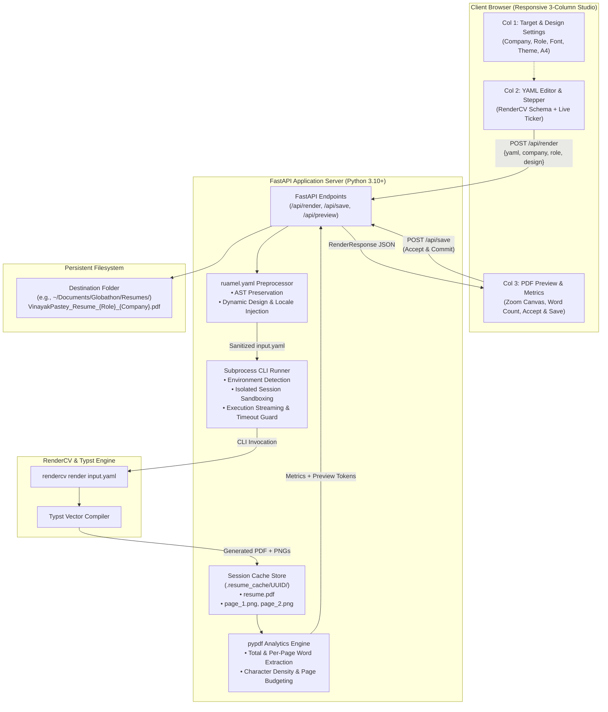

# Resume Builder 🚀

<div align="center">

[](https://www.python.org/)
[](https://fastapi.tiangolo.com/)
[](https://github.com/sinaatalay/rendercv)
[](https://typst.app/)
[](tests/)
[](LICENSE)
[](https://github.com/psf/black)

**A clean, minimal, and modern Python studio for generating, analyzing, and organizing programmatic resumes using RenderCV & Typst.**

[Overview](#overview) • [Architecture](#system-architecture) • [UI Blueprint](#ui-workspace-blueprint) • [Engineering Highlights](#engineering-highlights) • [Defaults](#default-configuration) • [API Reference](#api-reference) • [Quick Start](#quick-start) • [Testing](#testing--verification)

</div>

---

<a id="overview"></a>
## 📌 Overview

**Resume Builder** bridges the gap between programmatic, version-controlled CV specifications (YAML + Typst) and modern desktop application ergonomics. While tools like [RenderCV](https://github.com/sinaatalay/rendercv) offer compiler backends for typography and page budgeting, terminal workflows traditionally require repetitive CLI commands, manual PDF opening, guessing page overflows, and tedious manual renaming for distinct job applications.

Resume Builder solves this with a **viewport-locked 3-column reactive studio**:
1. **Target & Design Studio**: Dynamically inject typography, theme presets, page sizes, and phone formatting on top of any valid RenderCV YAML.
2. **YAML Editor & Reactive Pipeline**: Real-time syntax-checked editing paired with a single-line horizontal progress stepper and expandable live CLI subprocess logs.
3. **Analytics & Visual Canvas**: Instant sub-second Typst compilation, multi-page high-resolution rendering, `pypdf` page-by-page word density extraction, and an atomic **Accept & Commit** workflow that automatically saves standardized PDFs to your target application directory.

---

<a id="system-architecture"></a>
## 🏗️ System Architecture

The following diagram details the end-to-end data flow from client-side state changes to subprocess compilation and storage commitment:



---

<a id="ui-workspace-blueprint"></a>
## 📐 UI Workspace Blueprint

The interface is engineered with a strict **viewport-locked (`100vh overflow-hidden`)** grid on desktop screens. Rather than letting the whole page scroll awkwardly, each column acts as an independent scroll container:

```
+---------------------------------------------------------------------------------------------------------+
| [Badge] Resume Builder    [Sample YAML] [Upload YAML] [Reset]                         [Theme: Dark/Light] |
+------------------------------------+------------------------------------+-------------------------------+
| COLUMN 1: Target & Design          | COLUMN 2: Code Editor & Stepper    | COLUMN 3: Analytics & Preview |
| (lg:col-span-3, scrollable)        | (lg:col-span-4, scrollable)        | (lg:col-span-5, scrollable)   |
+------------------------------------+------------------------------------+-------------------------------+
| [Target Application]               | [YAML Config Editor]               | [Document Metrics]            |
|  * Company Name (e.g. OpenAI)      |  * Syntax-highlighted textarea     |  * Total Pages: 1             |
|  * Role Name (e.g. Systems Eng)    |  * RenderCV schema compatible      |  * Total Words: 369           |
|  * Save Directory                  |                                    |  * Words/Page: [308, 61]      |
|    (default: ~/Documents/...)      | [⚡ Render Resume Button]          |                               |
|  * Live Output Filename preview    |                                    | [Accept & Save Resume Button] |
|                                    | [1-Line Horizontal Stepper]        |  * Single-click commit        |
| [Design Settings]                  |  * [1] Parse YAML (37ms)           |  * Saved path confirmation    |
|  * Theme: Engineering Resumes      |  * [2] Inject Design (17ms)        |                               |
|  * Font Family: Calibri            |  * [3] RenderCV Typst (779ms)      | [Interactive Preview Canvas]  |
|  * Page Size: A4                   |  * [4] Analyze Metrics (37ms)      |  * Zoom In / Out / Fit        |
|  * Phone Format: International     |  * [5] Visual Preview (1ms)        |  * Crisp multi-page PNGs      |
|  * No Footer or Top Note: Checked  |  * [Terminal Log Toggle]           |  * Direct PDF Download link   |
|  * Allow Entry Page Breaks: Yes    |                                    |                               |
+------------------------------------+------------------------------------+-------------------------------+
| Made with ❤️ by Vinayak Pastey                                                                           |
+---------------------------------------------------------------------------------------------------------+
```

---

<a id="engineering-highlights"></a>
## 💡 Key Engineering Highlights

### 1. Subprocess CLI Decoupling with Real-Time Diagnostics
Instead of tightly coupling internal Python API hooks of RenderCV (which can change between minor releases), Resume Builder executes `rendercv render` as a decoupled subprocess via an isolated execution manager.
- Captures standard output and standard error streams in real time.
- Enforces an execution timeout guard to prevent hung compilation processes.
- Surfaces a collapsible **Raw CLI Console Output** viewer inside the single-line stepper for complete compiler observability.

### 2. AST-Aware YAML Preprocessing (`ruamel.yaml`)
Standard PyYAML serializers strip comments, collapse indentation, and alter data layouts. Resume Builder leverages `ruamel.yaml` in round-trip mode (`preserve_quotes = True`), allowing programmatic modification of:
- `cv.design.theme`
- `cv.design.text.font_family`, `header.name_font_family`, `section_titles.font_family`
- `cv.design.page.size`, `cv.design.page.show_page_numbering`, `cv.design.page.show_last_updated_date`
- `cv.design.entries.allow_page_break_in_entries`
- `cv.locale.phone_number_format`

All design overrides occur cleanly without destroying existing user comments or YAML formatting.

### 3. Viewport-Locked Ergonomics (`100vh`)
Unlike generic responsive layouts where tall editors push action buttons below the fold:
- Desktop UI locks to the browser viewport height (`calc(100vh - 4rem)` below the navigation bar).
- Each pane (Targeting, Editor, Preview Canvas) handles its own localized scrollbar.
- Mobile and tablet breakpoints automatically degrade into a single-column, touch-friendly stacking order.

### 4. Precision Page & Word Density Analytics (`pypdf`)
Resume length is critical for applicant tracking systems and hiring managers.
- Extracts total words, character count, and individual **per-page word counts** (e.g., `Page 1: 308 words | Page 2: 61 words`).
- Immediately highlights when content overflows onto an unintended second page, helping candidates adjust section density before exporting.

### 5. Safe "Accept & Commit" Pipeline
- Render operations compile safely into an isolated cache directory (`.resume_cache/<UUID>/`).
- Changes are only written to the user's permanent destination path (`~/Documents/Globathon/Resumes/...`) when the user clicks **Accept & Save**.
- Dynamic filename sanitization automatically formats names (e.g., `VinayakPastey_Resume_Lead_Systems_Architect_Globathon.pdf`), replacing hazardous filesystem characters while allowing custom filename overrides.

---

<a id="default-configuration"></a>
## ⚙️ Default Configuration Matrix

The application ships with strict, professional defaults configured out of the box:

| Property | Default Setting | Technical Configuration | Rationale |
| :--- | :--- | :--- | :--- |
| **Theme** | **Engineering Resumes** | `design.theme: "engineeringresumes"` | Clean, compact, ATS-friendly typography |
| **Primary Font** | **Calibri** | Applied across `text`, `header`, and `section_titles` | Clean sans-serif rendering across all platforms |
| **Page Size** | **A4** | `design.page.size: "a4"` | Standard international paper sizing |
| **Header / Footer Notes** | **Disabled** | `show_page_numbering: false`, `show_last_updated_date: false` | Eliminates distracting footers and top notes |
| **Phone Format** | **International** | `locale.phone_number_format: "international"` | Formats standard international dialing (`+1 609 999 9995`) |
| **Entry Page Breaks** | **Enabled** | `design.entries.allow_page_break_in_entries: true` | Prevents awkward white gaps across page boundaries |
| **Filename Schema** | **Dynamic** | `VinayakPastey_Resume_<Role>_<Company>.pdf` | Structured naming for job application tracking |
| **Save Destination** | **Auto-created** | `~/Documents/Globathon/Resumes` | Centralized folder for all generated resumes |

---

<a id="api-reference"></a>
## 🔌 REST API Reference

The backend exposes clean, fully typed REST endpoints documented interactively at `/docs` (OpenAPI Swagger UI).

### Endpoints Overview

| Method | Route | Description |
| :--- | :--- | :--- |
| `GET` | `/` | Serves the single-page application interface |
| `GET` | `/api/config` | Returns system defaults, font lists, themes, and supported formats |
| `GET` | `/api/sample` | Returns the bundled sample resume YAML specification |
| `POST` | `/api/render` | Primary pipeline: validates YAML, injects design, runs CLI, extracts metrics |
| `POST` | `/api/render-upload` | Multipart form variant for uploading `.yaml` files directly |
| `GET` | `/api/preview/{token}/page/{page_num}` | Serves crisp PNG preview images per page |
| `GET` | `/api/preview/{token}/pdf` | Serves the raw compiled PDF for browser viewing or download |
| `POST` | `/api/save` | Commits the rendered PDF from cache to the final target directory |

### Example: Render Resume (`POST /api/render`)

```json
{
  "yaml_content": "cv:\n  name: Vinayak Pastey\n...",
  "company_name": "Google",
  "role_name": "Senior Software Engineer",
  "save_directory": "~/Documents/Globathon/Resumes",
  "design": {
    "theme": "engineeringresumes",
    "font_family": "Calibri",
    "page_size": "a4",
    "no_footer_or_top_note": true,
    "phone_number_format": "international",
    "allow_page_break_in_entries": true
  }
}
```

**Response Payload (`RenderResponse`):**
```json
{
  "token": "801f22c7-8e88-47b1-bef0-cf662c9378c1",
  "success": true,
  "resolved_filename": "VinayakPastey_Resume_Senior_Software_Engineer_Google.pdf",
  "steps": [
    {
      "id": "validate_input",
      "name": "Validate YAML Specification",
      "status": "completed",
      "duration_ms": 37.8,
      "message": "Successfully parsed resume for 'Vinayak Pastey'"
    },
    {
      "id": "apply_design",
      "name": "Apply Design & Typography",
      "status": "completed",
      "duration_ms": 17.4,
      "message": "Configured engineeringresumes theme with Calibri font and A4 layout"
    },
    {
      "id": "execute_cli",
      "name": "Execute RenderCV CLI Engine",
      "status": "completed",
      "duration_ms": 779.3,
      "message": "CLI rendered Typst to PDF (66 KB)"
    },
    {
      "id": "analyze_metrics",
      "name": "Analyze Document Metrics",
      "status": "completed",
      "duration_ms": 37.4,
      "message": "2 pages, 369 words across document"
    },
    {
      "id": "prepare_preview",
      "name": "Generate Visual Preview",
      "status": "completed",
      "duration_ms": 0.5,
      "message": "Ready for review: 2 high-resolution page preview(s)"
    }
  ],
  "metrics": {
    "page_count": 2,
    "total_words": 369,
    "page_words": [308, 61],
    "character_count": 2509
  },
  "preview_urls": [
    "/api/preview/801f22c7-8e88-47b1-bef0-cf662c9378c1/page/1",
    "/api/preview/801f22c7-8e88-47b1-bef0-cf662c9378c1/page/2"
  ],
  "pdf_preview_url": "/api/preview/801f22c7-8e88-47b1-bef0-cf662c9378c1/pdf"
}
```

---

<a id="quick-start"></a>
## 🚀 Quick Start

### Prerequisites
- **Python**: Version 3.10 or higher
- **Operating System**: Linux, macOS, or Windows (WSL recommended)

### 1. Clone & Set Up Environment

```bash
# Clone the repository
git clone https://github.com/vinayvp/resume_builder.git
cd resume_builder

# Create and activate a virtual environment
python3 -m venv .venv
source .venv/bin/activate

# Install dependencies (includes rendercv[full] with Typst engine)
pip install -r requirements.txt
```

### 2. Launch the Application

Use the convenient runner script:
```bash
./run.sh
```

Or execute directly with Python:
```bash
python3 main.py
```

The server binds to `http://127.0.0.1:8000` and automatically opens your browser.

### 3. CLI Command Options

```bash
python3 main.py --help

Options:
  --host TEXT       Host IP to bind (default: 127.0.0.1)
  --port INTEGER    Port number to bind (default: 8000)
  --no-browser      Prevent the browser from opening automatically
  --reload          Enable auto-reload for local development
  --help            Show this message and exit
```

---

<a id="testing--verification"></a>
## 🧪 Testing & Verification

The repository includes a comprehensive, automated test suite covering unit operations, AST manipulations, CLI executions, and API routes.

### Running Pytest Suite

```bash
python3 run_tests.py
```

**Test Breakdown (11/11 Passed):**
- `tests/test_analyzer.py`
  - `test_analyze_pdf_valid`: Verifies `pypdf` text extraction, word counts, and page distribution.
  - `test_analyze_pdf_nonexistent`: Tests graceful handling of missing files.
- `tests/test_api.py`
  - `test_index_page`: Confirms SSR template rendering and default font injection.
  - `test_index_three_column_layout`: Validates 3-column grid structure, ticker components, and preview sections.
  - `test_api_config`: Verifies configuration endpoint returns all theme and font presets.
  - `test_api_sample`: Validates bundled sample resume YAML retrieval.
  - `test_api_render_and_preview_flow`: Full integration test executing the complete render, PNG preview, and save lifecycle.
- `tests/test_renderer.py`
  - `test_sanitize_name`: Tests URL/filesystem sanitization for filenames.
  - `test_build_filename_defaults`: Validates formatting: `VinayakPastey_Resume_<role>_<company>.pdf`.
  - `test_renderer_full_pipeline`: Tests live RenderCV CLI invocation and Typst compilation.
  - `test_renderer_invalid_yaml`: Confirms proper error containment on broken YAML syntax.

### Running End-to-End Programmatic Verification

Run the headless verification script to simulate the full user workflow:
```bash
python3 verify_e2e.py
```

---

<a id="repository-structure"></a>
## 📁 Repository Structure

```
resume_builder/
├── main.py                      # Application entrypoint & CLI dispatcher
├── run.sh                       # Quick launcher script (auto-venv detection)
├── run_tests.py                 # Pytest test suite runner
├── verify_e2e.py                # Headless end-to-end integration verification
├── requirements.txt             # Production & compilation dependencies
├── pyproject.toml               # Python package specification & pytest config
│
├── resume_builder/              # Core application package
│   ├── app.py                   # FastAPI web routes, static mounts & CORS
│   ├── cli.py                   # Click-powered CLI flags & Uvicorn runner
│   ├── config.py                # Presets, defaults, themes, fonts & cache paths
│   ├── models.py                # Pydantic v2 schemas (requests, responses, steps)
│   ├── renderer.py              # YAML preprocessor, CLI executor, preview cache
│   ├── analyzer.py              # pypdf page & token word count analyzer
│   │
│   ├── samples/
│   │   └── sample_resume.yaml   # Default preloaded RenderCV resume template
│   │
│   ├── static/
│   │   ├── css/
│   │   │   └── style.css        # Clean styling, scrollbars & responsive rules
│   │   ├── js/
│   │   │   └── app.js           # Reactive UI, ticker stepper & preview engine
│   │   └── img/
│   │       ├── badge-light.png  # Light mode branded badge
│   │       ├── badge-dark.png   # Dark mode branded badge
│   │       ├── favicon.png      # Application favicon
│   │       ├── favicon-light.png
│   │       └── favicon-dark.png
│   │
│   └── templates/
│       └── index.html           # Viewport-locked 3-column Jinja2 template
│
└── tests/                       # Automated test suite
    ├── test_analyzer.py         # PDF analytics unit tests
    ├── test_renderer.py         # Pipeline & naming unit tests
    └── test_api.py              # FastAPI endpoint integration tests
```

---

## 🛠️ Technology Stack

- **Backend Web Framework**: [FastAPI](https://fastapi.tiangolo.com/) (ASGI, async route handlers, Pydantic v2 data validation)
- **Compilation Engine**: [RenderCV](https://github.com/sinaatalay/rendercv) v2.3+ backed by the high-speed [Typst](https://typst.app/) vector typesetting compiler
- **YAML Engine**: [ruamel.yaml](https://yaml.readthedocs.io/) (Round-trip comment and quote preservation)
- **PDF Extraction**: [pypdf](https://pypdf.readthedocs.io/) (Page text streams and token counts)
- **Frontend Architecture**: Modern Vanilla JS, [Tailwind CSS](https://tailwindcss.com/), [Lucide Icons](https://lucide.dev/)
- **Test Harness**: [Pytest](https://pytest.org/), [HTTPX](https://www.python-httpx.org/)

---

## 👤 Author

**Vinayak Pastey**
- LinkedIn: [Vinayak Pastey](https://www.linkedin.com/)
- GitHub: [@vinayvp](https://github.com/vinayvp)

*Made with ❤️ by Vinayak Pastey*

---

## 📄 License

This project is licensed under the MIT License — see the [LICENSE](LICENSE) file for details.
